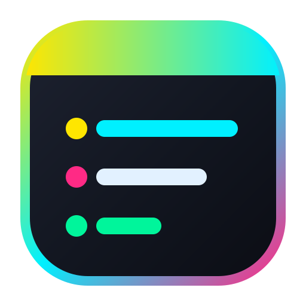

  
  <h1>✨ CyberNotes v2.1.0</h1>
  
<b>Modern, Ultra-Smooth Hardware-Accelerated Neon Sticky Notes for Windows</b>

---

**CyberNotes** is a fast, minimal, hardware-accelerated desktop sticky notes application for Windows with a sleek Cyberpunk neon aesthetic. Created by **Kandula Paul Saketh Maurya** ([@MauryaKandula](https://github.com/MauryaKandula)).

---

## 📦 Download & 1-Click Setup (For Users)

1. **Download the Setup ZIP**: [**`CyberNotes-v2.1.0-Windows-Setup.zip`**](https://github.com/MauryaKandula/cyber-notes/releases/download/v2.1.0/CyberNotes-v2.1.0-Windows-Setup.zip) (or grab [`CyberNotes.exe`](https://github.com/MauryaKandula/cyber-notes/releases/download/v2.1.0/CyberNotes.exe) from [Releases](https://github.com/MauryaKandula/cyber-notes/releases/tag/v2.1.0)).
2. **Extract & Run `Setup.bat`**: Installs dependencies, creates Desktop/Start Menu/Startup shortcuts with the CyberNotes icon, and launches **`CyberNotes.exe`**.

---

## 🌟 Key Features

- **144Hz+ Native Compositor Smoothness**: Native OS move and 8-edge resize hooks (`startSystemMove` / `startSystemResize`) for zero-latency dragging.
- **Native Sticky Notes Behavior**: Automatically restores open sticky notes when Windows starts (`--startup`), and keeps floating sticky notes open on your desktop when the main `All Notes` list is closed.
- **Gliding & Breathing Neon Caret**: Smoothly interpolated glowing cursor (`85ms` `OutCubic`) with idle breathing aura and active-line ambient glow.
- **Live Link & Tag Highlighter**: Real-time inline highlighting for `https://` URLs and `#tags` with 1-click smart action pills (`↗` open in browser, right-click to copy).
- **Tactile Click Ripple & Spring Animations**: Radial neon click ripples and spring-bounce transitions across note headers, color orbs, and formatting buttons.
- **7 Cyberpunk Neon Color Themes**: Neon Yellow (`#FFE600`), Cyber Cyan (`#00F0FF`), Electric Pink (`#FF2A85`), Neon Violet (`#B845FF`), Neon Mint (`#00F59B`), Frost Silver (`#E2F1FF`), and Crimson Glow (`#FF3B5C`).
- **Rich-Text & Freehand Neon Ink (`✎ Draw`)**: Bold (`Ctrl+B`), Italic (`Ctrl+I`), Underline (`Ctrl+U`), Strikethrough (`Ctrl+T`), Bullet Lists (`Ctrl+Shift+L`), and smooth vector ink sketching.
- **Local AppData SQLite WAL Storage**: Crash-safe persistence in `%LOCALAPPDATA%\CyberNotes\plum.sqlite` with 1-click import from Windows Sticky Notes.

---

## ⚖️ License & Legal Notice

- **Author & Copyright**: © 2026 **Kandula Paul Saketh Maurya** ([@MauryaKandula](https://github.com/MauryaKandula) | `mauryakpsofficial@gmail.com`).
- **License**: Released under the [MIT License](./LICENSE).
- **Clean-Room & Data Interoperability Notice**: CyberNotes is an original, clean-room software implementation written in Python and PyQt6. Optional database import interoperability with local SQLite note schemas is provided strictly for user data portability under 17 U.S.C. § 102(b) and 17 U.S.C. § 117. Microsoft, Windows, and Microsoft Sticky Notes are trademarks of Microsoft Corporation, which is not affiliated with or endorsing this project.
- **Third-Party Open-Source Notices**: Uses `PyQt6` (GPLv3 / Riverbank Computing), `SQLite3` (Public Domain), and `Python Standard Library` (PSF-2.0).
- **Security**: All notes are stored 100% locally on your device (`%LOCALAPPDATA%\CyberNotes\plum.sqlite`) with zero telemetry or cloud transmission.
